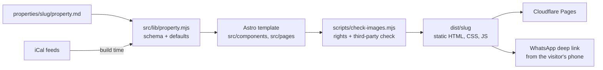

# tzimmer-site-generator

A static-site generator that turns one content file into a fast, Hebrew RTL website for a single vacation rental (צימר), built to move bookings from booking platforms to direct WhatsApp contact at zero hosting cost.

## Features

- One Astro template, one `properties/<slug>/property.md` per property; adding a property never touches `src/`
- Three routes per site: the story page, a gallery, and a shareable "pick your dates" booking page
- Booking with no server: availability from iCal feeds (Airbnb, Booking, Google Calendar) read at build time, then a prefilled WhatsApp message with dates and guests
- Scroll-driven storytelling: pinned hero, scroll-zoom entrance, crossfading room tour, optional 360 panoramas (Pannellum) or a Gaussian-splat embed
- Image-rights enforcement in the build: every image declares `source: real | placeholder | stock`; placeholders always carry a visible badge, stock is allowed only as texture, and external URLs or third-party resources fail the build
- Accent colour derived per property and checked for WCAG AA contrast
- Zero third-party requests at runtime: fonts, scripts and styles are self-hosted; motion respects `prefers-reduced-motion`
- One-command deploy to Cloudflare Pages (free tier), one project per property
- Hebrew user interface and Hebrew docs in `docs/`

## Architecture



## Stack

Astro, vanilla JS, CSS, Lenis, Embla Carousel, Pannellum, scroll-craft (vendored, MIT), sharp, Node.js scripts, Cloudflare Pages via Wrangler.

## Run

```bash
npm install
npm run new-property -- --slug=my-place --name="שם הצימר"
npm run build:one -- --slug=kramim-bagalil
npm run preview -- --slug=kramim-bagalil
npm run deploy -- --slug=kramim-bagalil      # after `npx wrangler login`
```

Optional environment variables (`.env.example`): `PROPERTY_SLUG`, `PROPERTY_ACCENT`, `SITE_URL`.

The included properties are invented demos (`kramim-bagalil`, `neve-tzuf`) that use badged placeholder imagery: Unsplash photos and CC0 Poly Haven panoramas, listed in `assets/placeholders/LICENSES.md`. Full Hebrew guide: `docs/GUIDE.he.md`; deploy guide: `docs/DEPLOY.he.md`.

## Tests

```bash
npm test
```

Self-checks for the iCal parser (DST-safe night blocking, broken and dead feeds that must not fail the build) and the accent-colour contrast logic: 16 assertions, offline, under a second.

Built by directing AI coding agents (Claude Code); I own the spec, architecture, testing and deployment.
